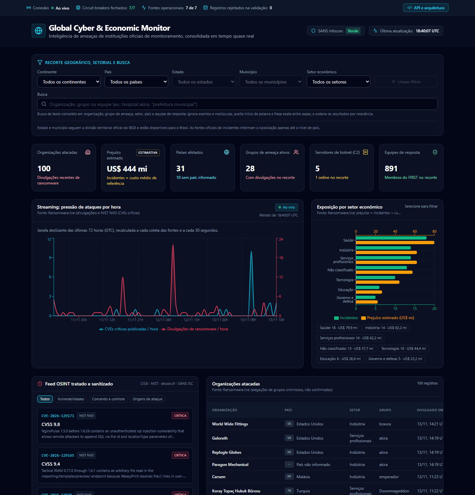

# Global Cyber & Economic Monitor

Painel de monitoramento global de incidentes cibernéticos, com estimativa de impacto econômico, alimentado por fontes públicas de inteligência de ameaças.



## 1. Visão geral

O sistema é composto por dois processos que se comunicam por um contrato versionado.

| Componente    | Responsabilidade                                                                                                   |
| ------------- | ------------------------------------------------------------------------------------------------------------------ |
| **Gateway**   | Serviço Node que coleta as fontes periodicamente, valida cada registro por esquema e publica um retrato unificado. |
| **Dashboard** | Aplicação React que recebe o retrato por fluxo contínuo (Server-Sent Events) e o apresenta com filtros.            |

O gateway existe porque várias fontes não permitem chamadas diretas do navegador (CORS). Ele também concentra cache, resiliência e validação em um único ponto.

## 2. Fontes integradas

| Fonte                  | Organização (país sede)                                | Conteúdo                                              | Ciclo  |
| ---------------------- | ------------------------------------------------------ | ----------------------------------------------------- | ------ |
| Ransomware.live        | Projeto comunitário (França)                           | Organizações divulgadas como vítimas de ransomware    | 5 min  |
| CISA KEV               | Cybersecurity and Infrastructure Security Agency (EUA) | Vulnerabilidades exploradas ativamente                | 1 h    |
| NIST NVD               | National Institute of Standards and Technology (EUA)   | CVEs de severidade crítica dos últimos 7 dias         | 15 min |
| SANS ISC / DShield     | SANS Internet Storm Center (EUA)                       | Nível Infocon e principais origens de ataque          | 5 min  |
| abuse.ch Feodo Tracker | abuse.ch (Suíça)                                       | Servidores de comando e controle de botnets           | 10 min |
| FIRST Teams            | Forum of Incident Response and Security Teams          | Diretório mundial de equipes de resposta a incidentes | 12 h   |
| IBGE Localidades       | Instituto Brasileiro de Geografia e Estatística        | Divisão territorial oficial: UFs e municípios         | 24 h   |

O IBGE é fonte de referência, e não de incidentes: alimenta os filtros de estado e município do Brasil.

A cobertura de todos os continentes decorre de duas dimensões: o país das organizações atacadas e o diretório do FIRST, que reúne equipes de resposta (CSIRT, SOC, PSIRT, ISAC) da América do Sul, América Central e Caribe, América do Norte, Europa, Ásia e Oriente Médio, Oceania e África.

## 3. Limites dos dados

Estas ressalvas também são exibidas no próprio painel.

1. **Organizações atacadas.** A lista reproduz alegações publicadas por grupos de ransomware. A presença de uma organização não confirma a ocorrência nem a extensão do ataque. Não existe fonte pública que relacione todos os ataques em curso no mundo.
2. **Prejuízo estimado.** Nenhuma fonte informa a perda financeira por incidente. O valor exibido é o número de incidentes multiplicado por um custo médio de referência (padrão: US$ 4,44 milhões, IBM Cost of a Data Breach Report 2025). Trata-se de ordem de grandeza. O parâmetro é configurável.
3. **Granularidade geográfica.** As fontes de incidentes informam a localização até o nível de país. Nenhuma instituição oficial publica ataques cibernéticos por estado ou município. Os filtros de estado e município do Brasil seguem a divisão territorial oficial do IBGE, mas não restringem os dados: com um deles selecionado, o painel avisa que os indicadores se referem ao país e não atribui ocorrências a localidades por suposição.
4. **Tempo real.** A atualização é contínua no painel, mas limitada pelo ciclo de publicação de cada fonte, indicado na tabela acima.
5. **Privacidade e segurança.** O gateway descarta os endereços de sites de vazamento e as capturas de tela fornecidos pela fonte de ransomware.

## 4. Execução

Requisito: Node.js 22.22.2 ou superior na linha 22, ou 24.15 ou superior (exigência do jsdom usado nos testes). O gateway executa TypeScript diretamente, sem etapa de compilação.

```bash
npm install
npm run dev            # gateway (porta 8787) e dashboard (porta 5173)
```

Produção, em processo único que serve a API e os arquivos estáticos:

```bash
npm run build
npm start              # http://127.0.0.1:8787
```

| Variável                     | Padrão      | Finalidade                                                         |
| ---------------------------- | ----------- | ------------------------------------------------------------------ |
| `HOST`                       | `127.0.0.1` | Interface de rede do gateway                                       |
| `PORT`                       | `8787`      | Porta do gateway                                                   |
| `GCEM_STATIC_DIR`            | (vazio)     | Diretório do build do dashboard a ser servido                      |
| `GCEM_ALLOWED_ORIGIN`        | (vazio)     | Origem autorizada via CORS, quando o dashboard é hospedado à parte |
| `GCEM_LOSS_PER_INCIDENT_USD` | `4440000`   | Custo médio de referência para a estimativa de prejuízo            |
| `GCEM_LOSS_SOURCE`           | (vazio)     | Citação da referência adotada pelo operador                        |
| `NODE_USE_ENV_PROXY`         | (vazio)     | Defina `1` para o gateway respeitar `HTTPS_PROXY`                  |

## 5. API do gateway

| Rota                      | Descrição                                                |
| ------------------------- | -------------------------------------------------------- |
| `GET /api/v1/snapshot`    | Retrato consolidado atual                                |
| `GET /api/v1/stream`      | Fluxo SSE: retrato atual na conexão e a cada nova coleta |
| `GET /api/v1/agencies`    | Diretório de equipes de resposta                         |
| `GET /api/v1/territories` | Divisão territorial oficial do Brasil (IBGE)             |
| `GET /api/v1/health`      | Situação do serviço e das fontes                         |

O formato das respostas é definido em `src/contract/threat-snapshot.ts` e validado nos dois lados.

## 6. Qualidade

| Comando                  | Finalidade                                                                  |
| ------------------------ | --------------------------------------------------------------------------- |
| `npm run typecheck`      | TypeScript em modo estrito                                                  |
| `npm run lint`           | ESLint, incluindo as fronteiras entre módulos                               |
| `npm run format:check`   | Formatação com Prettier                                                     |
| `npm test`               | Testes unitários, de contrato, de integração, de interface e de arquitetura |
| `npm run test:coverage`  | Testes com cobertura (limiar mínimo de 90% de linhas)                       |
| `npm run verify:sources` | Consulta as sete fontes reais e relata registros válidos e rejeitados       |
| `npm run check`          | Executa todas as verificações estáticas, os testes e o build                |

A arquitetura, as decisões de projeto e a estratégia de testes estão em [docs/ARQUITETURA.md](docs/ARQUITETURA.md).

## 7. Stack

Node.js, TypeScript, Zod, React 19, Vite, Tailwind CSS, Vitest e Testing Library.
